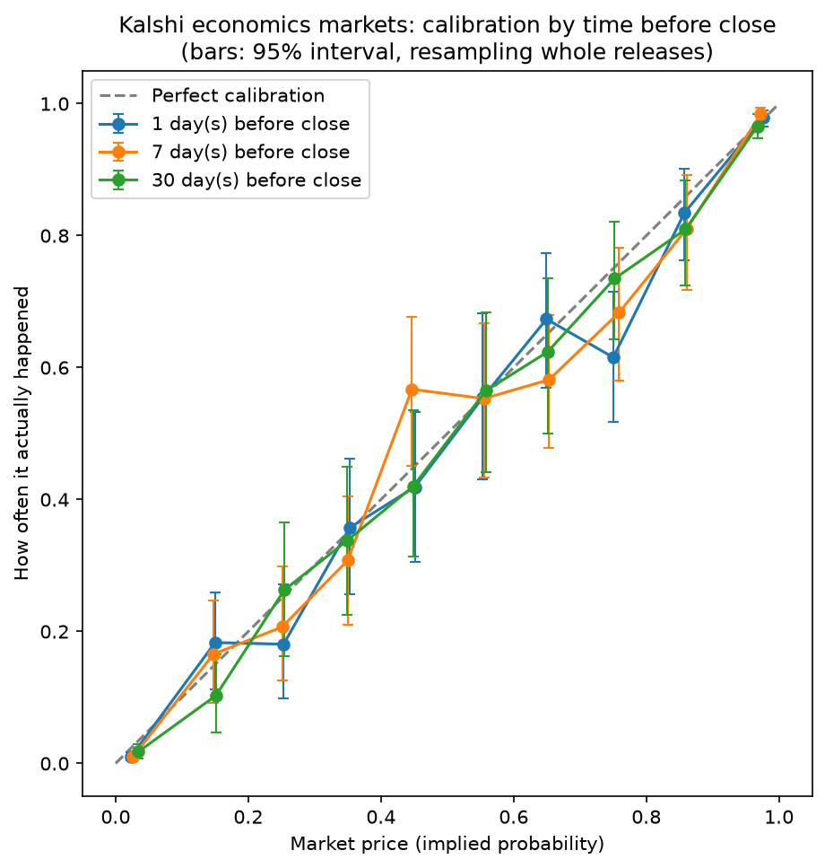
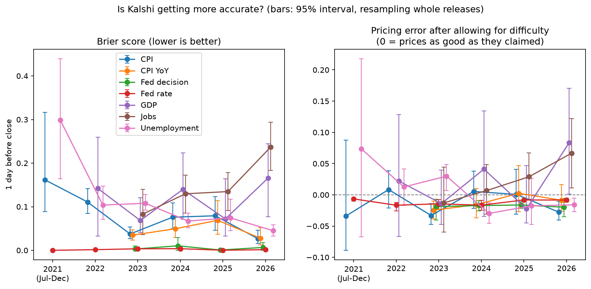

# Are Kalshi Economics Markets Calibrated?

**When a Kalshi market says 70%, does the event actually happen about 70% of the time?**

This project pulls every settled Kalshi contract in seven economics series (CPI monthly and
year-over-year, payrolls, unemployment, Fed decisions, the Fed funds rate and GDP, July 2021 –
October 2026), takes each market's price before the data release, and checks how often those
events really happened.

**[Live dashboard](https://kalshi-calibration-g5d69fgdf7ztnxstxevy2q.streamlit.app/)**

## Main finding

One day before release, across **2,484 contracts** from 189 data releases, Kalshi prices were off
from real outcome frequencies by **1.9 percentage points** on average, with a **Brier score of
0.072** (vs. 0.249 for always guessing the base rate). Accuracy ranged from near-perfect on both
Fed series to weakest on payrolls.

These overall numbers look better than with the original four series (1,162 contracts, 3.0 points,
Brier 0.100) mostly because the three added series are easier to call, not because pricing changed.
The original four's results are unchanged.



## Results by event type

Brier score (0 = perfect, 0.25 = coin flip). Lower is better.

| Event type | Series | Markets | Releases | 30 days before | 7 days before | 1 day before |
|---|---|---|---|---|---|---|
| Fed rate | `KXFED` | 413 | 41 | 0.013 | 0.007 | 0.002 |
| Fed decision | `KXFEDDECISION` | 145 | 29 | 0.033 | 0.014 | 0.005 |
| CPI YoY | `KXCPIYOY` | 671 | 47 | 0.086 | 0.044 | 0.042 |
| CPI (monthly) | `KXCPI` | 522 | 64 | 0.121 | 0.072 | 0.067 |
| Unemployment | `KXU3` | 599 | 63 | 0.084 | 0.086 | 0.080 |
| GDP | `KXGDP` | 183 | 21 | 0.121 | 0.100 | 0.112 |
| Jobs (payrolls) | `KXPAYROLLS` | 396 | 43 | 0.168 | 0.170 | 0.166 |

- **Fed markets are almost perfectly priced**, since the Fed signals its moves in advance. The
  rate brackets are even easier than the decision markets, because most strikes are far from the
  current rate. Both are slightly *underconfident*: outcomes were more certain than prices said.
- **CPI YoY is easier than monthly CPI.** Eleven of the twelve months in a year-over-year figure
  are already known, so less is left to guess. Both learn as the release approaches.
- **Unemployment is far easier than payrolls**, though both come from the same jobs report. The
  unemployment rate moves slowly; the payrolls number is noisy and barely gets easier a day out.

## Where the market missed

Each bucket's 95% interval comes from a bootstrap that resamples whole data releases 1,000 times.
A release is one report on one date. Sister series settle on the same report (CPI and CPI YoY,
payrolls and unemployment, both Fed series), so their contracts are resampled together.

| Price bucket | Contracts | Avg price | Actually happened | 95% interval |
|---|---|---|---|---|
| 0–10% | 899 | 2.3% | 1.0% | 0.4–1.7% |
| 10–20% | 131 | 15.0% | 18.3% | 11.2–25.9% |
| 70–80% | 104 | 75.0% | 61.5% | 51.8–71.4% |

- **70–80% is still the clearest miss, and now by more.** One day before release, these contracts
  were priced at 75% but happened 62% of the time. The interval now excludes the price by about
  3.5 points (it was about 1 point with the original four series). The original four's 63
  contracts hit 59%. The 41 new ones hit 66%: the same direction, but not significant on their own.
  The jobs report drives most of it: payrolls (33 contracts, 55%) and unemployment (27, 59%).
  The miss shrinks at longer horizons: 68% at 7 days out and 74% at 30 days out.
- **0–10% is a new, small flag.** Long shots priced around 2% happened 1% of the time, and the
  gap shows up at all three horizons. It's only about one point, but it's consistent across almost
  every event type (payrolls is the exception), which fits the well-known pattern of long shots
  being slightly overpriced.
- **10–20% is not significant.** Its interval includes the 15% average price.
- **Some flags will happen by chance.** 30 buckets were tested (10 buckets × 3 horizons), so at 95%
  confidence about 1.5 would be flagged by chance alone. The other flag, 40–50% at 7 days out,
  misses its interval by less than a point.

## Is Kalshi getting more accurate?

No overall change from 2021 to 2026. Within single event types, CPI and unemployment scores
improved and payrolls got worse, and most of the CPI and payrolls changes come from how hard the
questions were.



Prices 1 day before release, grouped by the year of the release. Two things change over the
years besides skill, and both are handled:

- **Event-type mix.** Series start in different years (payrolls and Fed decisions in 2023, CPI
  YoY at the end of 2022), and some, like the Fed, are far easier to call. So trends are measured
  *within* each event type (each type's average level is removed), and the "vs. usual" columns
  compare each contract with its own type's all-years average.
- **Question difficulty.** A perfectly priced 50% contract still scores 0.25. The *pricing
  error* subtracts the Brier score the prices themselves predicted, p(1−p). It averages zero for
  a well-calibrated market however hard the questions are. Positive means prices were
  overconfident (too sure), negative means underconfident.

All event types together (95% intervals resample whole releases):

| Year | Contracts | Releases | Close calls (10–90%) | Brier | Brier vs. usual for type | Pricing error vs. usual |
|---|---|---|---|---|---|---|
| 2021 (Jul–Dec) | 20 | 16 | 75% | 0.157 (0.086–0.248) | +0.092 (+0.024 to +0.182) | −0.001 (−0.054 to +0.073) |
| 2022 | 278 | 36 | 36% | 0.085 (0.064–0.110) | +0.026 (+0.009 to +0.046) | +0.010 (−0.006 to +0.026) |
| 2023 | 487 | 36 | 28% | 0.055 (0.040–0.070) | −0.014 (−0.024 to −0.004) | −0.008 (−0.021 to +0.005) |
| 2024 | 498 | 36 | 35% | 0.072 (0.055–0.090) | −0.004 (−0.018 to +0.011) | −0.007 (−0.021 to +0.009) |
| 2025 | 513 | 36 | 30% | 0.068 (0.050–0.088) | −0.003 (−0.019 to +0.016) | −0.000 (−0.014 to +0.016) |
| 2026 | 688 | 29 | 32% | 0.079 (0.051–0.109) | +0.002 (−0.016 to +0.022) | +0.007 (−0.009 to +0.025) |

Change per year, within event type. For Brier, negative = improving. For pricing error, the sign
shows which way prices drifted; whether that's better depends on which side of zero they started.

| | Brier | Pricing error |
|---|---|---|
| All types | −0.003 (−0.008 to +0.003), noise | +0.002 (−0.003 to +0.007), noise |
| CPI | **−0.015 (−0.023 to −0.006)** | −0.004 (−0.011 to +0.004), noise |
| CPI YoY | −0.002 (−0.010 to +0.008), noise | +0.006 (−0.001 to +0.016), noise |
| Jobs (payrolls) | **+0.051 (+0.023 to +0.076)** | **+0.028 (+0.002 to +0.053)**, borderline |
| Unemployment | **−0.018 (−0.028 to −0.010)** | **−0.011 (−0.019 to −0.004)** |
| Fed decision | −0.000, noise | −0.000, noise |
| Fed rate | −0.000, noise | **+0.002 (+0.001 to +0.004)**, tiny |
| GDP | +0.011, noise | +0.015, noise |

- **No overall trend.** After controlling for event type, neither the Brier score nor the
  pricing error moved by more than noise.
- **CPI scores improved, but the questions got easier.** Close calls fell from 46% of CPI
  contracts in 2022 to 22% in 2026. After allowing for that, CPI pricing shows no trend.
- **Payrolls got worse, about half from harder questions.** 84% of 2026 payroll contracts were
  close calls. The rest is a borderline decline in pricing, driven by 2026 (10 releases). Adding
  data didn't change this, because the payrolls data is the same. Worth watching, not yet a finding.
- **Unemployment improved, on the same jobs reports.** Its prices went from overconfident in 2023
  (+0.030) to slightly underconfident in 2026 (−0.016). Payrolls getting worse is specific to the
  payrolls number, not a general decline in pricing the jobs report.
- **The Fed rate's flag is tiny:** prices drifted from underconfident toward zero on a market
  that's almost always right.
- **Sixteen trends were tested,** so about one would be flagged by chance.
- **Small samples:** 2021 has 20 contracts (its high "vs. usual" score comes mostly from 5
  unemployment contracts), and GDP has 3–4 releases a year, so their intervals are wide (for GDP,
  probably still too narrow). The calibration gap (in `yearly.csv`) is pushed up by noise in small
  samples, so it isn't used for the trend.

## Method

1. **Data:** every settled market in seven Kalshi series (`KXCPI`, `KXCPIYOY`, `KXPAYROLLS`, `KXU3`,
   `KXFEDDECISION`, `KXFED`, `KXGDP`) from the public API, combining live and historical
   endpoints: 2,929 markets and 196,525 daily price records. All strikes are "above X" or the
   Fed decision's named outcomes; contracts are scored on their settled result, so strike values
   aren't used. Five markets (a duplicate listing of the January 2024 Fed meeting) have no price
   history and drop out.
2. **Price snapshot:** for each market, the last daily price at least 1, 7 or 30 days before close.
   Price = midpoint of best bid and ask, or the last trade if the spread exceeded 20¢.
3. **Calibration:** contracts grouped into 10-point price buckets; each bucket's average price
   compared with the share that settled yes.
4. **Brier score:** mean of (price − outcome)², overall and by event type.
5. **Confidence intervals:** 95% bootstrap interval on each bucket's hit rate, resampling whole
   releases (one report on one date, so sister series stay together) 1,000 times. A gap is
   significant when the average price falls outside it.
6. **Over time:** year of each release (`close_time`), 1 day before close. Trends are fixed-effects
   slopes within event type, with release-level bootstrap intervals; see the section above.

**Caveats:** 68% of contracts were priced below 10% or above 90% the day before, and those easy
calls make the overall Brier score look better. Payrolls and Fed decision data start in 2023, CPI
YoY at the end of 2022.

## Tools

Python (requests, pandas, matplotlib), DuckDB + SQL, Streamlit, GitHub.

## Run it yourself

```
pip install requests pandas duckdb matplotlib streamlit
python pull_all.py      # pull markets and daily prices (~25 min)
python build_db.py      # load into DuckDB
python analysis.py      # calibration, Brier scores, charts
streamlit run app.py    # dashboard
```

## Files

| File | What it does |
|---|---|
| `explore.py` | First look at one raw market from the API |
| `find_series.py` | Lists economics series on Kalshi |
| `pull_all.py` | Pulls all settled markets and daily price history |
| `build_db.py` | Loads CSVs into DuckDB and runs SQL checks |
| `analysis.py` | Calibration tables, Brier scores and charts |
| `yearly.csv`, `yearly_trend.csv` | Yearly results and trends written by `analysis.py`, read by the dashboard |
| `app.py` | Streamlit dashboard |

Built with AI assistance (Claude) for code generation; analysis design and interpretation are my own.