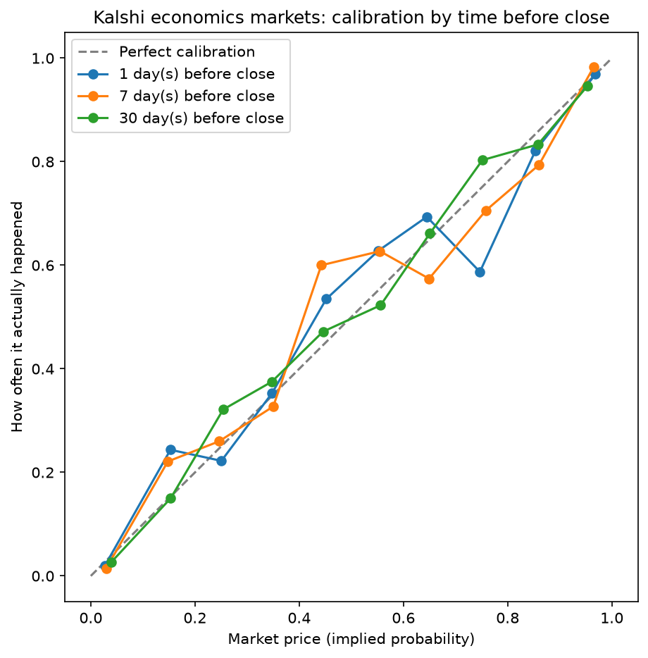
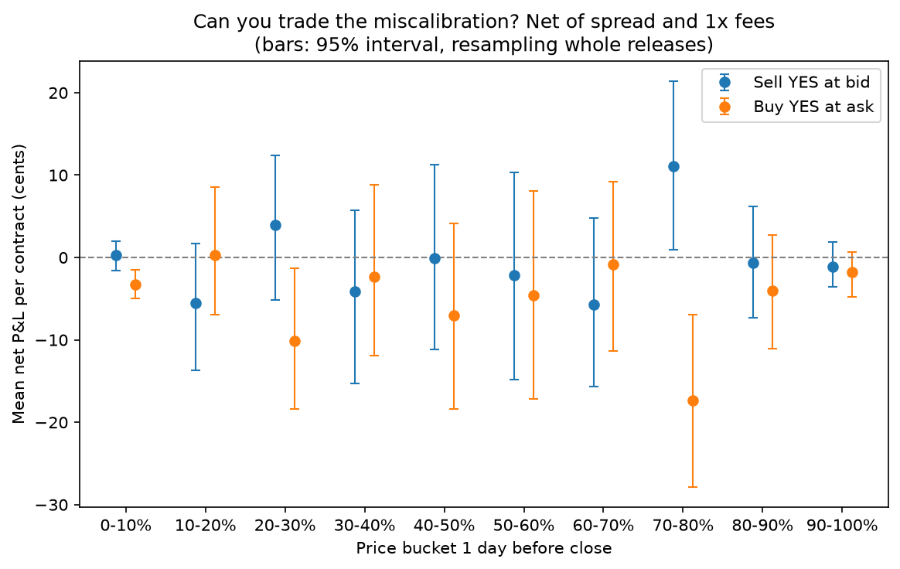
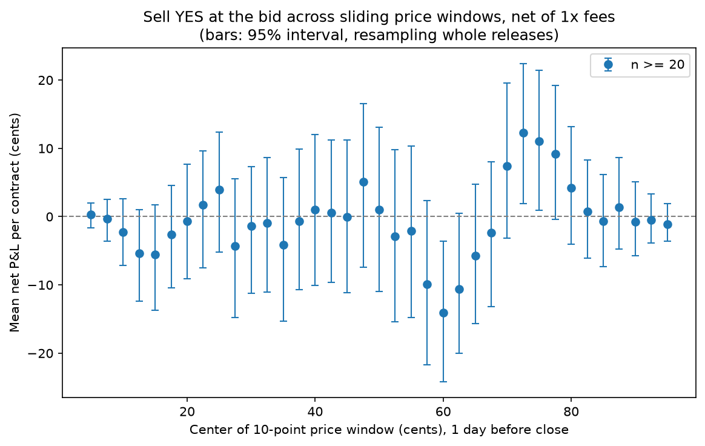
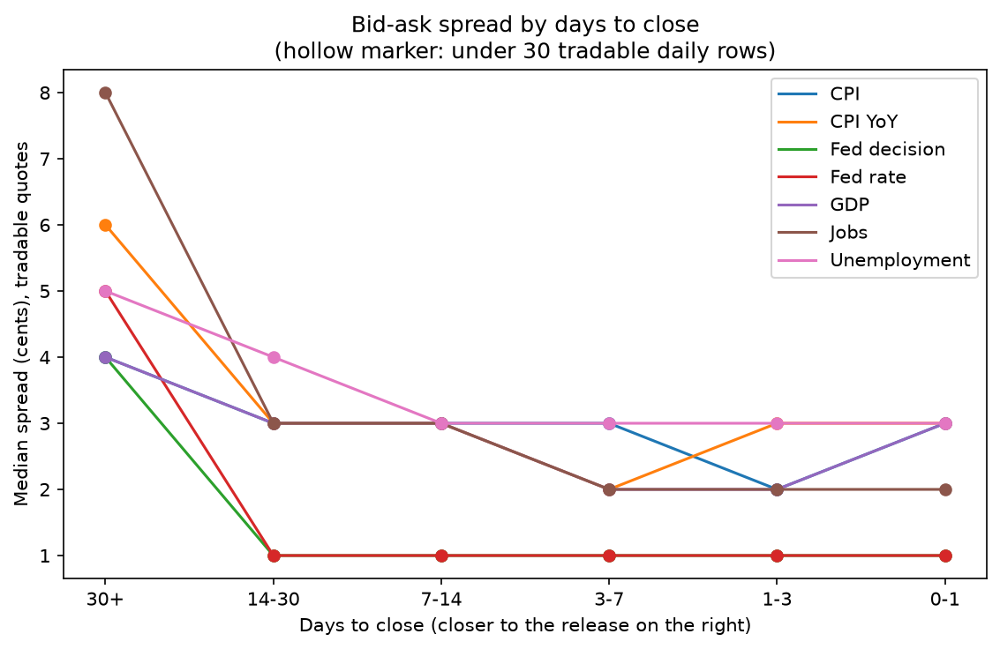
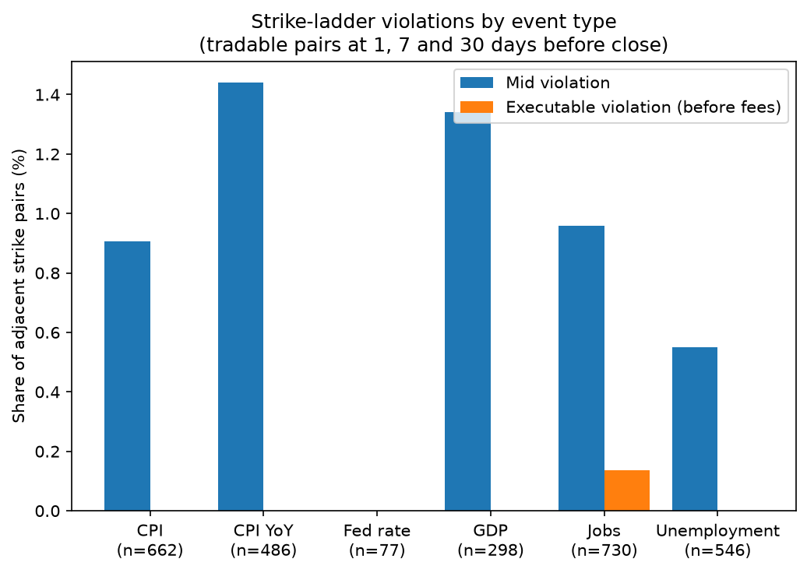
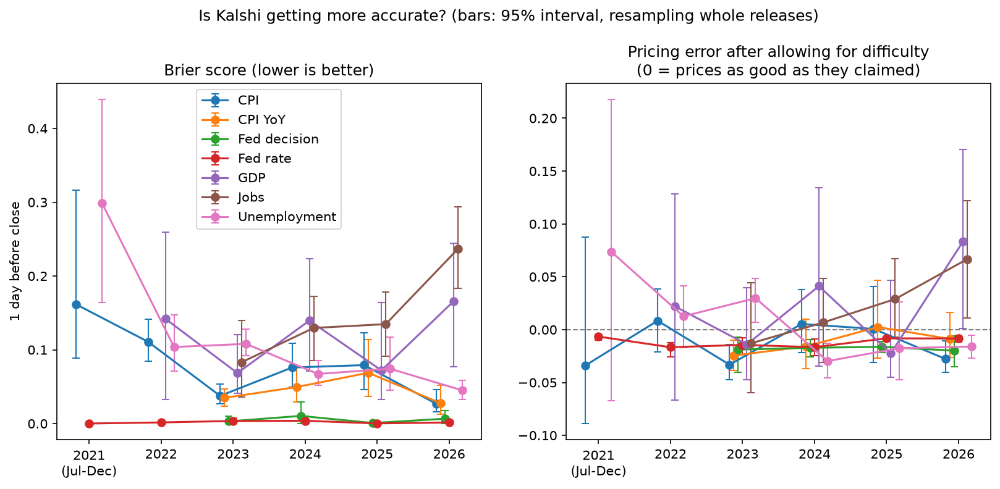

# Are Kalshi Economics Markets Calibrated?

**When a Kalshi market says 70%, does the event actually happen about 70% of the time?**

This project pulls every settled Kalshi contract in seven economics series (CPI monthly and
year-over-year, payrolls, unemployment, Fed decisions, the Fed funds rate and GDP, July 2021 –
October 2026), takes each market's price before the data release, and checks how often those
events really happened.

**[Live dashboard](https://kalshi-calibration-g5d69fgdf7ztnxstxevy2q.streamlit.app/)**

## Main finding

One day before release, across **2,484 contracts** from 189 data releases, Kalshi prices were off
from real outcome frequencies by **1.9 percentage points** on average, with a **Brier score of
0.072** (vs. 0.249 for always guessing the base rate). Accuracy ranged from near-perfect on both
Fed series to weakest on payrolls.

These overall numbers look better than with the original four series (1,162 contracts, 3.0 points,
Brier 0.100) mostly because the three added series are easier to call, not because pricing changed.
The original four's results are unchanged.



## Results by event type

Brier score (0 = perfect, 0.25 = coin flip). Lower is better.

| Event type | Series | Markets | Releases | 30 days before | 7 days before | 1 day before |
|---|---|---|---|---|---|---|
| Fed rate | `KXFED` | 413 | 41 | 0.013 | 0.007 | 0.002 |
| Fed decision | `KXFEDDECISION` | 145 | 29 | 0.033 | 0.014 | 0.005 |
| CPI YoY | `KXCPIYOY` | 671 | 47 | 0.086 | 0.044 | 0.042 |
| CPI (monthly) | `KXCPI` | 522 | 64 | 0.121 | 0.072 | 0.067 |
| Unemployment | `KXU3` | 599 | 63 | 0.084 | 0.086 | 0.080 |
| GDP | `KXGDP` | 183 | 21 | 0.121 | 0.100 | 0.112 |
| Jobs (payrolls) | `KXPAYROLLS` | 396 | 43 | 0.168 | 0.170 | 0.166 |

- **Fed markets are almost perfectly priced**, since the Fed signals its moves in advance. The
  rate brackets are even easier than the decision markets, because most strikes are far from the
  current rate. Both are slightly *underconfident*: outcomes were more certain than prices said.
- **CPI YoY is easier than monthly CPI.** Eleven of the twelve months in a year-over-year figure
  are already known, so less is left to guess. Both learn as the release approaches.
- **Unemployment is far easier than payrolls**, though both come from the same jobs report. The
  unemployment rate moves slowly; the payrolls number is noisy and barely gets easier a day out.

## Where the market missed

Each bucket's 95% interval comes from a bootstrap that resamples whole data releases 1,000 times.
A release is one report on one date. Sister series settle on the same report (CPI and CPI YoY,
payrolls and unemployment, both Fed series), so their contracts are resampled together.

| Price bucket | Contracts | Avg price | Actually happened | 95% interval |
|---|---|---|---|---|
| 0–10% | 899 | 2.3% | 1.0% | 0.4–1.7% |
| 10–20% | 131 | 15.0% | 18.3% | 11.2–25.9% |
| 70–80% | 104 | 75.0% | 61.5% | 51.8–71.4% |

- **70–80% is still the clearest miss, and now by more.** One day before release, these contracts
  were priced at 75% but happened 62% of the time. The interval now excludes the price by about
  3.5 points (it was about 1 point with the original four series). The original four's 63
  contracts hit 59%. The 41 new ones hit 66%: the same direction, but not significant on their own.
  The jobs report drives most of it: payrolls (33 contracts, 55%) and unemployment (27, 59%).
  The miss shrinks at longer horizons: 68% at 7 days out and 74% at 30 days out.
- **0–10% is a new, small flag.** Long shots priced around 2% happened 1% of the time, and the
  gap shows up at all three horizons. It's only about one point, but it's consistent across almost
  every event type (payrolls is the exception), which fits the well-known pattern of long shots
  being slightly overpriced.
- **10–20% is not significant.** Its interval includes the 15% average price.
- **Some flags will happen by chance.** 30 buckets were tested (10 buckets × 3 horizons), so at 95%
  confidence about 1.5 would be flagged by chance alone. The other flag, 40–50% at 7 days out,
  misses its interval by less than a point.

## Can you trade it?

Would the 70–80% miss have survived the bid-ask spread and Kalshi's fees? `tradability.py`
simulates selling YES at the bid (or buying YES at the ask) one day before release and holding
to settlement, with today's taker fee of 0.07 × P × (1 − P) per contract.



**In one sentence:** selling YES at the bid on every tradable 70–80% contract made 11.1¢ per
contract after fees (95% interval 0.9¢ to 21.4¢, 102 contracts from 74 releases), and the same
rule made 10–12¢ in each half of the data when chosen on the other half, but neither half's
interval excludes zero, so it's a lead worth watching, not a proven edge.

| Sell YES at the bid, 70–80% bucket | Contracts | Net P&L per contract | 95% interval |
|---|---|---|---|
| All years, no fees | 102 | +12.4¢ | +2.3¢ to +22.8¢ |
| All years, 1x fees | 102 | +11.1¢ | +0.9¢ to +21.4¢ |
| All years, 2x fees | 102 | +9.7¢ | −0.4¢ to +20.0¢ |
| Rule picked on 2021–2024, tested on 2025–2026 (1x fees) | 58 | +11.7¢ | −3.4¢ to +26.3¢ |
| Rule picked on 2025–2026, tested on 2021–2024 (1x fees) | 44 | +10.2¢ | −2.9¢ to +25.9¢ |

- **The spread and fees are small next to the miss.** In this bucket the average bid was 73.2¢,
  the contracts happened 60.8% of the time, the spread averaged 3.7¢ and the fee 1.4¢.
- **The out-of-sample test picks the same rule both ways.** Choosing the best bucket and side
  using only 2021–2024 gives "sell YES at 70–80%", and so does choosing on 2025–2026. The profit
  is about the same size in the period that wasn't used to choose, but with 44–58 contracts
  each interval includes zero.
- **By event type, nothing is clear on its own.** Payrolls made +16.5¢ (33 contracts) and
  unemployment +14.5¢ (26), both with intervals that include zero. Every other type has under 20
  contracts in this bucket.
- **No other bucket is profitable.** Of the 20 bucket-and-side combinations tested, this is the
  only one with an interval entirely above zero, and about 0.5 would land there by chance.
- **102 contracts here vs. 104 above:** two of the 104 had a spread over 20¢ and are excluded.
  Overall 1,387 of the 2,484 contracts had a tradable quote; 1,078 had no bid or no ask (almost
  all priced under 10% or over 90%) and 19 had a spread over 20¢.

**Caveats:**

- **Daily data.** The quote is each day's closing bid and ask, not a price available at a chosen moment.
- **No depth.** It assumes one contract at a time fills at the quoted price. Real size would move the price.
- **In-sample selection.** The 70–80% bucket was chosen after seeing the outcomes. Only the two
  out-of-sample rows avoid that, and neither excludes zero.
- **Fee approximation.** The 0.07 formula is today's general schedule, confirmed in Kalshi's
  October 2026 CFTC filing. Kalshi's fees have changed since 2021, which is why 0x and 2x are
  shown. I could not confirm from Kalshi's fee schedule whether these series have their own
  rates. Kalshi also rounds each order's fee up to the next cent, which costs more on one-contract orders.
- **Multiple buckets.** Twenty combinations were tested at once.

### Robustness checks

`tradability_checks.py` runs three checks on the 70–80% sell-YES result, all fixed before
looking at their results. **The result is weaker than it first looked.** It passes the timing
check, but it loses significance under a volume filter and when the price window shifts by 5 points.



| Check | Contracts | Net P&L per contract | 95% interval |
|---|---|---|---|
| Baseline (70–80%, 1x fees) | 102 | +11.1¢ | +0.9¢ to +21.4¢ |
| Traded on the snapshot day (volume > 0) | 95 | +10.7¢ | −0.5¢ to +21.0¢ |
| Cumulative volume ≥ 100 contracts | 102 | +11.1¢ | +0.9¢ to +21.4¢ |
| Window 65–75 | 99 | +7.4¢ | −3.2¢ to +19.5¢ |
| Window 67.5–77.5 | 99 | +12.3¢ | +1.9¢ to +22.4¢ |
| Window 72.5–82.5 | 96 | +9.2¢ | −0.4¢ to +19.2¢ |
| Window 75–85 | 109 | +4.2¢ | −4.1¢ to +13.2¢ |
| Fee rounded up, 1-contract orders (2.0¢ fee) | 102 | +10.4¢ | +0.3¢ to +20.8¢ |
| Fee rounded up, 100-contract orders (1.37¢ fee) | 102 | +11.1¢ | +0.9¢ to +21.4¢ |

- **Timing: no look-ahead found.** The stored bid, ask and last price are each daily candle's
  closing values, stamped at the candle's end (midnight US Eastern). In the 70–80% sample the
  quote is 31 to 104 hours older than the market's close (median 32), and none is under 24
  hours. Daily data can't show how long those quotes stood or how much size they held.
- **Volume: thin markets aren't the explanation, but the margin is.** These contracts are
  actively traded (median 2,544 contracts on the snapshot day, 21,558 in total by then).
  Dropping the 7 with no trades that day barely moves the average, but the interval then
  includes zero.
- **Windows: the profit is a narrow bump, not a broad pattern.** Of 37 overlapping 10-point
  windows, only 67.5–77.5 and 70–80 have an interval entirely above zero. Moving the window 5
  points either way loses that. One window, 55–65, is significantly *negative* (−14.0¢, −24.2¢
  to −3.6¢), meaning those contracts happened more often than priced. The 37 windows overlap,
  so they act like roughly 9 independent tests.
- **Calibration regression: no overall tilt.** A logistic regression of outcome on the log-odds
  of the price (statsmodels) gives a slope of 0.99 (0.89 to 1.12) and an intercept of −0.15
  (−0.45 to 0.16), where slope 1 and intercept 0 mean perfectly calibrated. So prices as a whole
  are not too extreme. The smooth fit puts a 75¢ contract at 71.8% (65.3% to 78.3%), against the
  60.8% the bucket actually hit. The 70–80% miss is a local dip that the overall fit doesn't
  explain, which is what noise in one bucket would also look like.
- **Fee rounding costs little.** Rounding the fee up to the next cent on one-contract orders
  takes about 0.6¢; on 100-contract orders it's negligible.

**Where that leaves it:** the 70–80% profit is real in this sample and survives costs, but it
depends on exactly where the bucket is drawn and sits next to a window with the opposite sign.
With no overall tilt in prices, the evidence fits "noise in one price range" as well as it fits
"a tradable edge".

## Market quality: what does it cost to trade?

A descriptive look at every daily quote (193,607 market-days, not only the 1/7/30-day
snapshots): how often there is a real two-sided quote, how wide the spread is, and whether the
strike ladders make sense. The design was written and committed first, in
[METHOD_market_quality.md](METHOD_market_quality.md). No significance tests here.

**Cost** = half the bid-ask spread plus the taker fee, 0.07 × P × (1 − P), per contract held to
settlement. A **tradable quote** has a bid above 0, an ask below $1.00 and a spread of 20¢ or less.

Median all-in cost per contract at 1x fees, by days to close. In brackets: the share of
market-days with a tradable quote.

| Event type | 30+ days | 14–30 | 7–14 | 3–7 | 1–3 | 0–1 |
|---|---|---|---|---|---|---|
| CPI | 3.61¢ (78%) | 2.46¢ (77%) | 2.21¢ (76%) | 2.20¢ (73%) | 2.12¢ (70%) | 2.20¢ (63%) |
| CPI YoY | 4.21¢ (44%) | 2.33¢ (54%) | 2.20¢ (51%) | 2.04¢ (50%) | 2.20¢ (50%) | 2.39¢ (43%) |
| Fed decision | 3.10¢ (60%) | 1.10¢ (63%) | 0.80¢ (56%) | 0.80¢ (48%) | 0.74¢ (44%) | 0.74¢ (33%) |
| Fed rate | 3.42¢ (68%) | 1.10¢ (33%) | 0.80¢ (29%) | 0.80¢ (23%) | 0.80¢ (18%) | 0.93¢ (16%) |
| GDP | 2.98¢ (91%) | 2.42¢ (88%) | 2.33¢ (88%) | 2.10¢ (88%) | 2.06¢ (84%) | 2.52¢ (74%) |
| Jobs | 5.12¢ (94%) | 2.76¢ (89%) | 2.56¢ (92%) | 2.25¢ (92%) | 2.21¢ (90%) | 2.16¢ (88%) |
| Unemployment | 3.86¢ (58%) | 2.74¢ (69%) | 2.47¢ (69%) | 2.39¢ (70%) | 2.24¢ (66%) | 2.27¢ (66%) |

All days pooled:

| Event type | Market-days | Tradable quote | Median spread | Median daily volume | Cost at 0x / 1x / 2x fees |
|---|---|---|---|---|---|
| CPI | 28,817 | 76% | 4¢ | 0 | 2.00¢ / 3.08¢ / 4.24¢ |
| CPI YoY | 24,786 | 48% | 4¢ | 0 | 2.00¢ / 2.93¢ / 3.91¢ |
| Fed decision | 10,899 | 59% | 2¢ | 121 | 1.00¢ / 2.10¢ / 3.15¢ |
| Fed rate | 70,568 | 64% | 5¢ | 0 | 2.50¢ / 3.32¢ / 4.26¢ |
| GDP | 12,607 | 90% | 3¢ | 39 | 1.50¢ / 2.75¢ / 3.91¢ |
| Jobs | 30,026 | 92% | 6¢ | 0 | 3.00¢ / 4.61¢ / 6.09¢ |
| Unemployment | 15,904 | 65% | 4¢ | 0 | 2.00¢ / 2.99¢ / 4.02¢ |



- **A typical trade costs about 3¢ per contract.** Across all tradable quotes the median spread
  is 4¢ and the median all-in cost is 3.37¢ at 1x fees (2.00¢ with no fees, 4.48¢ at 2x).
  69.7% of market-days have a tradable quote.
- **It gets cheaper and busier close to the release.** The median spread is 5¢ more than 30
  days out and 2–3¢ inside 30 days. Median daily volume goes from 0 more than 30 days out to
  1,276 contracts in the last day. But the share of tradable quotes *falls*, from 71% to 58%,
  likely because more strikes become near-certain and lose one side of the quote.
- **Fed markets are cheapest near the meeting, Jobs is the most expensive overall.** Inside two
  weeks, both Fed series cost about 0.8¢, though only 16–29% of Fed rate market-days are
  tradable then. Jobs has the widest median spread (6¢, and 8¢ more than 30 days out).
- **Cost peaks at middle prices.** It is 4.72¢ for contracts priced 40–60% and under 2¢ below
  10% or above 90%. The spread is 6¢ in the middle against 3¢ at the ends, and the fee
  formula is also largest at 50%.
- **More volume goes with tighter spreads, and not weakly.** The rank correlation between daily
  volume and spread is −0.27 to −0.70 depending on event type. Most days have no trades at all:
  32–72% of tradable market-days had zero volume, so volume terciles could only be formed
  properly for Fed decision and GDP.
- **The strike ladders are consistent, and that result is dull.** Across 710 ladders and 2,799
  adjacent strike pairs with tradable quotes at 1, 7 and 30 days out, 27 pairs (1.0%) had the
  higher strike's mid above the lower strike's, by a median of 1 point (largest 8). Only one
  pair crossed in a way you could trade (a Jobs ladder in June 2026: 70¢ bid at the higher
  strike against a 69¢ ask at the lower), worth 1¢ before fees and −1.97¢ after. Nothing
  survives fees.



**Caveats:**

- **Daily closing quotes.** Each quote is the day's closing bid and ask. Two strikes' quotes may
  not have stood at the same instant, and daily data can't show how long a quote lasted.
- **No depth.** Every cost assumes one contract fills at the quoted price.
- **Fee schedule.** Today's general taker formula is applied to all years.
- **Legacy vs. new close times can't really be compared.** Only 23 markets, from July 2021 to
  January 2022, had the old 7pm-evening-before close; they account for 829 market-days against
  107,778 for morning closes, and Jobs has none. Fed markets close around 1:55pm on meeting
  day and fit neither group. "Days to close" therefore isn't the same distance to the release
  for every market. The per-era numbers are in `market_quality.csv`.
- **Ladder pairs from different days are excluded.** 859 of 5,610 adjacent pairs had snapshots
  from different days and were not compared.
- **The calibration prices are slightly less tidy than the mids.** Using the price column from
  the calibration analysis (which falls back to the last trade when the spread is wide), 126 of
  4,751 pairs (2.7%) are out of order.

**Conclusion:** trading these markets costs a median of about 3.4¢ per contract all-in, less
near the release and at extreme prices, and the strike ladders are internally consistent: of
2,799 tradable adjacent pairs, one crossed before fees and none after.

## Is Kalshi getting more accurate?

No overall change from 2021 to 2026. Within single event types, CPI and unemployment scores
improved and payrolls got worse, and most of the CPI and payrolls changes come from how hard the
questions were.



Prices 1 day before release, grouped by the year of the release. Two things change over the
years besides skill, and both are handled:

- **Event-type mix.** Series start in different years (payrolls and Fed decisions in 2023, CPI
  YoY at the end of 2022), and some, like the Fed, are far easier to call. So trends are measured
  *within* each event type (each type's average level is removed), and the "vs. usual" columns
  compare each contract with its own type's all-years average.
- **Question difficulty.** A perfectly priced 50% contract still scores 0.25. The *pricing
  error* subtracts the Brier score the prices themselves predicted, p(1−p). It averages zero for
  a well-calibrated market however hard the questions are. Positive means prices were
  overconfident (too sure), negative means underconfident.

All event types together (95% intervals resample whole releases):

| Year | Contracts | Releases | Close calls (10–90%) | Brier | Brier vs. usual for type | Pricing error vs. usual |
|---|---|---|---|---|---|---|
| 2021 (Jul–Dec) | 20 | 16 | 75% | 0.157 (0.086–0.248) | +0.092 (+0.024 to +0.182) | −0.001 (−0.054 to +0.073) |
| 2022 | 278 | 36 | 36% | 0.085 (0.064–0.110) | +0.026 (+0.009 to +0.046) | +0.010 (−0.006 to +0.026) |
| 2023 | 487 | 36 | 28% | 0.055 (0.040–0.070) | −0.014 (−0.024 to −0.004) | −0.008 (−0.021 to +0.005) |
| 2024 | 498 | 36 | 35% | 0.072 (0.055–0.090) | −0.004 (−0.018 to +0.011) | −0.007 (−0.021 to +0.009) |
| 2025 | 513 | 36 | 30% | 0.068 (0.050–0.088) | −0.003 (−0.019 to +0.016) | −0.000 (−0.014 to +0.016) |
| 2026 | 688 | 29 | 32% | 0.079 (0.051–0.109) | +0.002 (−0.016 to +0.022) | +0.007 (−0.009 to +0.025) |

Change per year, within event type. For Brier, negative = improving. For pricing error, the sign
shows which way prices drifted; whether that's better depends on which side of zero they started.

| | Brier | Pricing error |
|---|---|---|
| All types | −0.003 (−0.008 to +0.003), noise | +0.002 (−0.003 to +0.007), noise |
| CPI | **−0.015 (−0.023 to −0.006)** | −0.004 (−0.011 to +0.004), noise |
| CPI YoY | −0.002 (−0.010 to +0.008), noise | +0.006 (−0.001 to +0.016), noise |
| Jobs (payrolls) | **+0.051 (+0.023 to +0.076)** | **+0.028 (+0.002 to +0.053)**, borderline |
| Unemployment | **−0.018 (−0.028 to −0.010)** | **−0.011 (−0.019 to −0.004)** |
| Fed decision | −0.000, noise | −0.000, noise |
| Fed rate | −0.000, noise | **+0.002 (+0.001 to +0.004)**, tiny |
| GDP | +0.011, noise | +0.015, noise |

- **No overall trend.** After controlling for event type, neither the Brier score nor the
  pricing error moved by more than noise.
- **CPI scores improved, but the questions got easier.** Close calls fell from 46% of CPI
  contracts in 2022 to 22% in 2026. After allowing for that, CPI pricing shows no trend.
- **Payrolls got worse, about half from harder questions.** 84% of 2026 payroll contracts were
  close calls. The rest is a borderline decline in pricing, driven by 2026 (10 releases). Adding
  data didn't change this, because the payrolls data is the same. Worth watching, not yet a finding.
- **Unemployment improved, on the same jobs reports.** Its prices went from overconfident in 2023
  (+0.030) to slightly underconfident in 2026 (−0.016). Payrolls getting worse is specific to the
  payrolls number, not a general decline in pricing the jobs report.
- **The Fed rate's flag is tiny:** prices drifted from underconfident toward zero on a market
  that's almost always right.
- **Sixteen trends were tested,** so about one would be flagged by chance.
- **Small samples:** 2021 has 20 contracts (its high "vs. usual" score comes mostly from 5
  unemployment contracts), and GDP has 3–4 releases a year, so their intervals are wide (for GDP,
  probably still too narrow). The calibration gap (in `yearly.csv`) is pushed up by noise in small
  samples, so it isn't used for the trend.

## Method

1. **Data:** every settled market in seven Kalshi series (`KXCPI`, `KXCPIYOY`, `KXPAYROLLS`, `KXU3`,
   `KXFEDDECISION`, `KXFED`, `KXGDP`) from the public API, combining live and historical
   endpoints: 2,929 markets and 196,525 daily price records. All strikes are "above X" or the
   Fed decision's named outcomes; contracts are scored on their settled result, so strike values
   aren't used. Five markets (a duplicate listing of the January 2024 Fed meeting) have no price
   history and drop out.
2. **Price snapshot:** for each market, the last daily price at least 1, 7 or 30 days before close.
   Price = midpoint of best bid and ask, or the last trade if the spread exceeded 20¢.
3. **Calibration:** contracts grouped into 10-point price buckets; each bucket's average price
   compared with the share that settled yes.
4. **Brier score:** mean of (price − outcome)², overall and by event type.
5. **Confidence intervals:** 95% bootstrap interval on each bucket's hit rate, resampling whole
   releases (one report on one date, so sister series stay together) 1,000 times. A gap is
   significant when the average price falls outside it.
6. **Over time:** year of each release (`close_time`), 1 day before close. Trends are fixed-effects
   slopes within event type, with release-level bootstrap intervals; see the section above.

**Caveats:** 68% of contracts were priced below 10% or above 90% the day before, and those easy
calls make the overall Brier score look better. Payrolls and Fed decision data start in 2023, CPI
YoY at the end of 2022.

## Tools

Python (requests, pandas, matplotlib), DuckDB + SQL, Streamlit, GitHub.

## Run it yourself

```
pip install requests pandas duckdb matplotlib streamlit
python pull_all.py      # pull markets and daily prices (~25 min)
python build_db.py      # load into DuckDB
python analysis.py      # calibration, Brier scores, charts
python tradability.py   # would the 70-80% miss survive spread and fees?
python tradability_checks.py   # robustness checks (needs: pip install statsmodels)
python market_quality.py   # spreads, volume and cost to trade
python consistency.py      # strike-ladder consistency
streamlit run app.py    # dashboard
```

## Files

| File | What it does |
|---|---|
| `explore.py` | First look at one raw market from the API |
| `find_series.py` | Lists economics series on Kalshi |
| `pull_all.py` | Pulls all settled markets and daily price history |
| `build_db.py` | Loads CSVs into DuckDB and runs SQL checks |
| `analysis.py` | Calibration tables, Brier scores and charts |
| `yearly.csv`, `yearly_trend.csv` | Yearly results and trends written by `analysis.py`, read by the dashboard |
| `tradability.py` | Trading simulation net of spread and fees; writes `tradability.csv` |
| `tradability_checks.py` | Timing, volume and bucket-sensitivity checks; writes `tradability_checks.csv` |
| `METHOD_market_quality.md` | Design for the market quality analysis, committed before the results |
| `market_quality.py` | Spread, volume and cost profile from every daily quote; writes `market_quality.csv` |
| `consistency.py` | Strike-ladder consistency checks; writes `consistency.csv` |
| `app.py` | Streamlit dashboard |

Built with AI assistance (Claude) for code generation; analysis design and interpretation are my own.